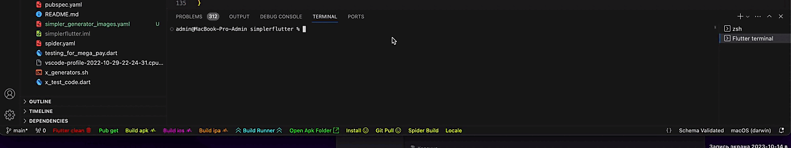
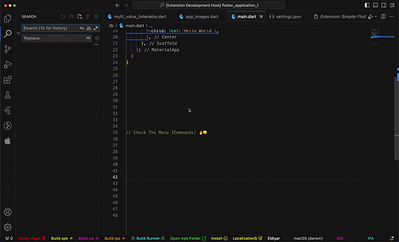
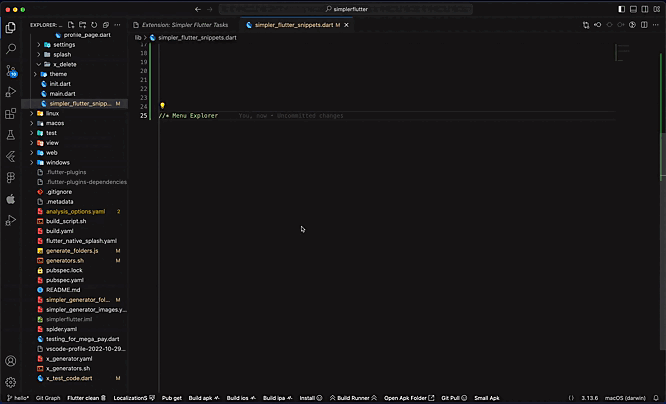
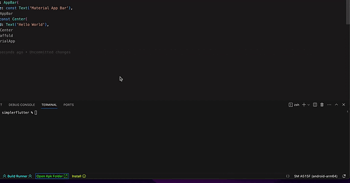
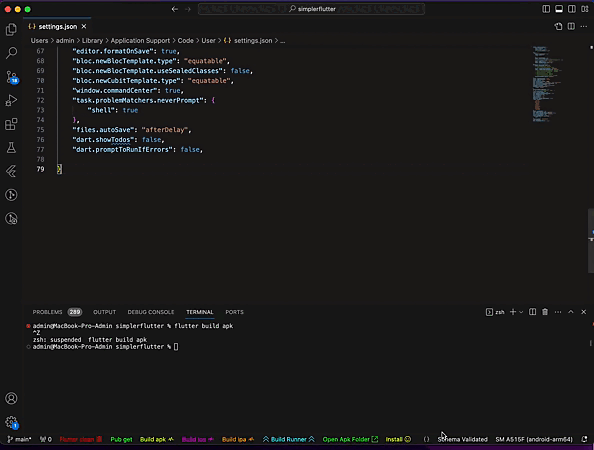
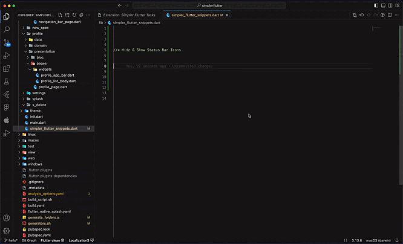

<div align="center">
  <h1>Task for Visual Studio Code</h1>
</div>


- Keep in mind that if you install 'THE Simpler Flutter Tasks' you will have two additional extensions installed for work



## Menu Explorer Vs Code

<!--  -->


## Open APk Folder



## Hide / Show Icon

<!--  -->


`Copy this json and add to your VsCode settings.json` 

```json
  "SimplerFlutterTasks.flutterCleanIcon": "show",
  "SimplerFlutterTasks.flutterPubGetIcon": "hide",
  "SimplerFlutterTasks.buildApkIcon": "show",
  "SimplerFlutterTasks.iosIcon": "show",
  "SimplerFlutterTasks.ipaIcon": "show",
  "SimplerFlutterTasks.buildRunnerIcon": "show",
  "SimplerFlutterTasks.installIcon": "show",
  "SimplerFlutterTasks.openApkIcon": "show",
  "SimplerFlutterTasks.gitPullIcon": "hide",
  "SimplerFlutterTasks.smallApkIcon": "hide",
  "SimplerFlutterTasks.easyLocalizationsIcon": "hide",
  "SimplerFlutterTasks.createNewTerminal": false,
```

<div align="center">
  <h1>Custom Commands</h1>
</div>


`Create your Custom Commands`  
`copy this json and add to your VsCode settings.json` 
create more commands

- [Icons for Simpler Flutter Tasks](https://code.visualstudio.com/api/references/icons-in-labels#icon-listing)


### Custom Commands
```json
"SimplerFlutterTasks.customCommandsList": [
    {
        "label": "LocalizationS $(github-action)",
        "command": "flutter pub get",
        "enabled": true,
        "color": "#00ff22",
        "position": "right",
        "warningDialog": false,
        "askerForCommand": true
    },
    {
        "label": "New Branch",
        "command": "git checkout -b",
        "enabled": true,
        "color": "#00ff11",
        "position": "left",
        "warningDialog": false,
        "askerForCommand": true
    }
],
```


### Table of Contents
A set of helpful Flutter and Dart commands for day to day Flutter development.

- [Installation](#installation)
- [Features](#Features)
- [Commands](#Commands)
- [Requirements](#Requirements)
- [Reference](#Reference)

## Installation

- Name of Package - Simpler Flutter tasks - [Icons](https://code.visualstudio.com/api/references/icons-in-labels#icon-listing)
- [Visual Studio Code | Visual Studio Marketplace](https://marketplace.visualstudio.com/items?itemName=Eldiyar-Dev.simpler-flutter-tasks)

## Features

Simply Flutter / Dart commands

I'm working hard to select all the day to day commands, so wait for more commands!.

## Commands

`Flutter related Commands`  

| Flutter quick commands   |    Visibility icons   |
| -------------------------|-----------------------|
| `Flutter clean`          |    default  -  show   |
| `Flutter pub get`        |    default  -  hide   |
| `Flutter build apk`      |    default  -  show   |
| `Flutter build ios`      |    default  -  hide   |
| `Flutter build ipa`      |    default  -  hide   |
| `flutter install`        |    default  -  hide   |
| `Build runner`           |    default  -  show   |
| `Open Build Folder`      |    default  -  show   |
| `Git pull`               |    default  -  hide   |
| `Small Apk`              |    default  -  hide   |
| `Easy Localizations`     |    default  -  show   |


## Not Released yet --------- ❌

Planning 

### 3.2.0
  - Settings Tabs
    - Flutter clean choices
      - flutter clean and flutter pub get
      - just flutter clean

    - Optimize Starting Ios Commands  ❌
     - For
        - WINDOWS ❌ -> ✅
        - LINUX ❌ -> ✅
        - MAC ✅

## Release Notes 🔥 🔥 🔥 🔥 🔥 🔥 🔥 ------- ✅

### 3.1.5
  - "warningDialog": true,
  - "askerForCommand": true
  - example
custom commands in user json settings 

```
"SimplerFlutterTasks.customCommandsList": [
        {
            "label": "Go to DEV",
            "command": "git checkout DEV && git pull",
            "enabled": true,
            "color": "#00ff11",
            "position": "left",
            "warningDialog": true,
            "askerForCommand": false
        },
        {
            "label": "push",
            "command": "git push --set-upstream origin",
            "enabled": true,
            "color": "#00ff11",
            "position": "left",
            "warningDialog": true,
            "askerForCommand": false
        },
        {
            "label": "Commit",
            "command": "git add . && git commit -m ",
            "enabled": true,
            "color": "#00ff11",
            "position": "left",
            "warningDialog": false,
            "askerForCommand": false
        },
        {
            "label": "Rebase",
            "command": "git pull --rebase origin main",
            "enabled": true,
            "color": "#00ff11",
            "position": "left",
            "warningDialog": true,
            "askerForCommand": false
        },
        {
            "label": "New Branch",
            "command": "git checkout -b",
            "enabled": true,
            "color": "#00ff11",
            "position": "left",
            "warningDialog": false,
            "askerForCommand": true
        }
    ],
```
### 3.1.4
  - Changed Model of Flavor 
### Old Format
```
 "SimplerFlutterTasks.Flavors":  [
        {
            "title": "prod",
            "package": "com_packages_of_your_app"
        },
        {
            "title": "staging",
            "package": "com_packages_of_your_app"
        },
        {
            "title": "dev",
            "package": "com_packages_of_your_app"
        }
    ]
```
### New Format
```
"SimplerFlutterTasks.Flavors": {
  "path": "lib/main",
  "flavors": [
      {
          "title": "prod",
          "package": "com_packages_of_your_app"
      },
      {
          "title": "staging",
          "package": "com_packages_of_your_app"
      },
      {
          "title": "dev",
          "package": "com_packages_of_your_app"
      }
  ]
    },
```
    
### 3.1.3
  - refactor opening new terminal and added counter
  - added killing the port terminal killall -9 dart
    - Waiting for another flutter command to release the startup lock
    

### 3.1.2
  - added settings of Extension Simpler FLutter Snippets
    - add/remove Bloc/Cubit builder wrapper
    - add/remove Bloc/Cubit consumer wrapper
    - add/remove Stack wrapper
    - turn on/turn off remove widget short cut
    - add Builder Runner With Filter
    
### 3.1.1
  - added some new feature for Flavor
    - adb uninstall
    - adb flutter run release
    - json of flavor was changed
    - removed apple icon from top editor
    - fixed the command flutter clean for windows
    - 

### 3.1.0
  - Added Flutter Flavor
    - KeyBinding alt/option + f 
    - flutter-tasks.activateFlavor
    - Commands example default

      - PROD
        - flutter build apk --flavor prod -t lib/main_prod.dart
        - flutter build appbundle --flavor prod -t lib/main_prod.dart
        - flutter build ios --flavor prod
        - flutter build ipa --flavor prod
        - open Bundle
        - open Apk by ENV -> Flavor

        - adb install build/app/outputs/flutter-apk/app-prod-release.apk

      - Staging
        - flutter build apk --flavor staging -t lib/main_staging.dart
        - flutter build ios --flavor staging
        - flutter build ipa --flavor staging

        - open Apk by ENV -> Flavor
        - adb install build/app/outputs/flutter-apk/app-staging-release.apk

      - Dev
        - flutter build apk --flavor dev -t lib/main_dev.dart
        - flutter build ios --flavor dev
        - flutter build ipa --flavor dev

        - open Apk by ENV -> Flavor
        - adb install build/app/outputs/flutter-apk/app-dev-release.apk

  

### 3.0.8
  - Just removed Icons happy New Year 2024
  - adding information that installing 3 extension
  
### 3.0.7
  - Just Changed Icons happy New Year 2024
  - Slowed down some animation icons
  
### 3.0.6
  - New Commands  ---- > 🔥 🔥 🔥
    - Flutter ✅
      - flutter logs 
      - flutter pub cache clean | flutter pub cache repair
      - flutter downgrade YOUR_FLUTTER_VERSION
      - flutter --help --verbose

    - Android (Gradle) ✅
      - Dependencies
      - SigningReport
      - Build
      - Clean

    - IOS  ✅
      - pod setup
      - pod init
      - pod version
      - Deleting ✅
        - .symlinks
        - Pods
        - Podfile.lock
        - De integrate
      - cocoapods ✅
        - sudo gem install cocoapods
        - brew install cocoapods
        - brew upgrade cocoapods
        - brew link --overwrite cocoapods
      
    - Settings Tabs ✅

      - Other Settings
        - Always Expand  - Всегда Открытый когда запускается Visual Studio Code -
        - Always Collapsed  - Всегда Закрытый когда запускается Visual Studio Code -

      - Activate Custom Commands 

      - Settings Bloc Extension 
        - Cubit Type +
    
    - firebase's commands tab  ✅

  - Optimize Starting Ios Commands  ❌
     - For
        - WINDOWS ❌
        - LINUX ❌
        - MAC ✅

### 3.0.5
  - I Will add to Explorer tab ✅
    - without settings ✅

  - Added Colorized The Commands ✅
    - Switch between Colorized / White

### 3.0.4
  - Editing Easy Localizations ✅
  - Added descriptions for some Commands ✅
  - Add Open Ios Folder ✅
  - Add Open Ipa Folder ✅


### 3.0.3
  - Optimize Starting Ios Commands ✅ -- beta test only for MAC
    - WINDOWS ❌
    - LINUX ❌
    - MAC ✅
      - pod install
      - pod update
      - pod cache clean --all
      - pod repo update

  - Added refresh Tab's button
  - Added Collapse All Tab's button
  - Added Tab's Git Hub ✅
    - you can't start the command only COPY | it will be safer this way
      - Init Repo
      - Git Cancelers
      - Git Repo


### 3.0.2
  - adding Tab's settings ✅
    - I will add settings to my other extensions. ✅
      - `Simpler FLutter Tasks`
      - `Simpler FLutter Snippets`
      - `Simpler FLutter Generators`


      
### 3.0.1 
  - Added Tabs
    - Android ✅
    - IOS ✅
    - Copy The Command on menu View ✅
    - Start Command on menu view ✅


### 3.0.0 
  - Updated Menu Explorer 
    - added new tab `Settings` ✅
      - Hide / Show Icon -> `Now it’s convenient to change the visibility of status bar icons` ✅
      - Start + Copy The Command ✅
      - Added Numbering The Command ✅ 

### 2.8.7 
  - Auto Updating Localizations from Json, 
       now you do not have to reload vs code ✅
  - Vs Code `Menu Explorer Commands`  🔥 🔥 🔥
    - Build Runner ✅
      - dart run build_runner build
      - dart run build_runner build --delete-conflicting-outputs
      - dart run build_runner build --delete-conflicting-outputs -v
    - Flutter Commands ✅
      - flutter --version
      - flutter doctor -v
      - flutter pub outdated
      - flutter upgrade
      - flutter pub get
      - flutter pub upgrade
      - flutter devices
      - flutter analyze
      - dart fix --apply
      - dart format .
      - flutter clean
    - .... so wait for more commands....!
  
  - Optimized Code - (Commands) ✅

### 2.8.3-4-5-6
  - what's new
    - custom commands  [Try Now](#Custom-Commands)
        - right / left
        - "position": "right",  --> NEW ✅ ✅ <br><br> 
        

    - Start the Command to new Terminal <br>
        - `"SimplerFlutterTasks.createNewTerminal": true,`

### 2.8.2
  - Fixed Open Apk Folder
    - Mac ✅
    - Linux ✅
    - Windows ✅

### 0.2.6
  - Fixed Custom Commands
  - The Command `flutter clean` now work with `flutter pub get`
### 0.2.5
  - Added feature
    - hide / show icon
      - Flutter Clean
      - Flutter Pub get

### 0.2.3-4
  - Custom Commands auto updating, now you don't have to reload the VisualStudio Code

### 0.2.2
  - Новая Фича [new feature]
  - Custom Commands
    - Create your own commands

### 0.2.1
  - New Commands
    - Small Apk:
    - Spider Build:
    - Easy Localizations
      - default value 
        - dart run easy_localization:generate -S assets/langs -O lib/langs
        - dart run easy_localization:generate -S assets/langs -f keys -o locale_keys.g.dart 
        
  - Added Hide / Show Icon
    - flutter clean:
    - flutter pub get:
    - flutter build apk:
    - flutter build ios:
    - flutter build ipa:
    - flutter install:
    - Build runner:
    - Open Apk Folder:
    - Small Apk:
    - Spider Build:
    - Easy Localizations:
  
  - Change Visibility icons in Extension's Settings |Simpler Flutter Tasks|

### 0.2.0

  - Git pull
    - Just Git Pulling
    - adding Beta testing hide or show icon " git pull icon by default is hide "
    - open settings vs code -> search simpler flutter tasks -> there the set hide or show git pull icon
   
### 0.1.9

- Optimized
  - starting commands

### 0.1.8

- Flutter Install
  - installing

### 0.1.6-7

- Fixed bugs with terminal

### 0.1.5

- Build runner:
  - dart run build_runner build --delete-conflicting-outputs
- Open Apk Folder:
  - opening apk folder, if not exists "app-release.apk" -> open |build/outputs|
    - Mac ✅
    - Linux ❌
    - Windows ❌

### 0.1.0

- flutter clean:
  - just cleaning project.
- flutter pub get:
  - get all dependencies 
- flutter build apk:
  - Build for android
- flutter build ios:
  - Build for ios
- flutter build ipa:
  - Build for ipa


### 0.0.1

Initial release


## Requirements

Vscode: ^1.82.0

## Reference

[Simpler Flutter Snippet](https://marketplace.visualstudio.com/items?itemName=Eldiyar-Dev.simpler-flutter-snippets)
[Simpler Flutter Generator](https://marketplace.visualstudio.com/items?itemName=Eldiyar-Dev.simpler-flutter-generator)

Enjoy !!!! 😉 
